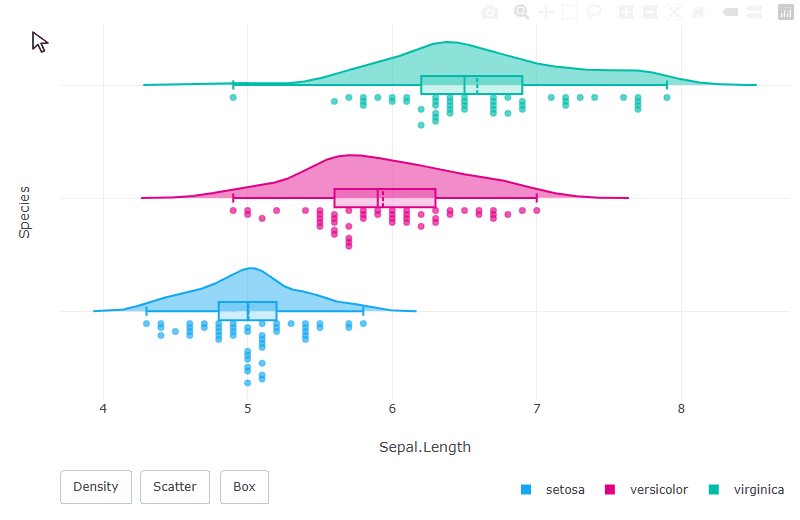
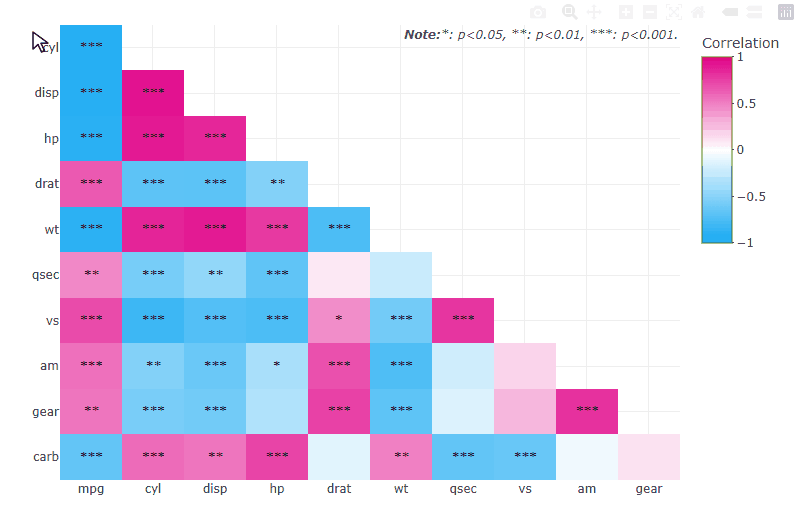

# npdar-misc

Helper scripts for [npdar](https://github.com/rcpch/npdar) that don't belong in the package.

## Demo GIFs

Demos of `plot_raincloud_ly()` and `plot_corrmat_ly()`:





The scripts record the cursor, hover and button actions on the two examples, for the npdar README
and pkgdown site.

- `render_plotly.R` renders the example plots to HTML in `build/`.
- `record_plotly.py` records them in headless Edge (Playwright) and saves the GIFs to `gifs/`,
  then copies them to `../npdar/man/figures` if that folder exists.

Needs R (`pkgload`, `plotly`, `htmlwidgets`), Python 3, and Microsoft Edge.

```powershell
pip install playwright pillow
Rscript render_plotly.R
python record_plotly.py
```

The recorded sequence is in `run_raincloud()` and `run_corrmat()`. In the raincloud plot, the box
stats show when hovering inside the box a few pixels above the median line.
